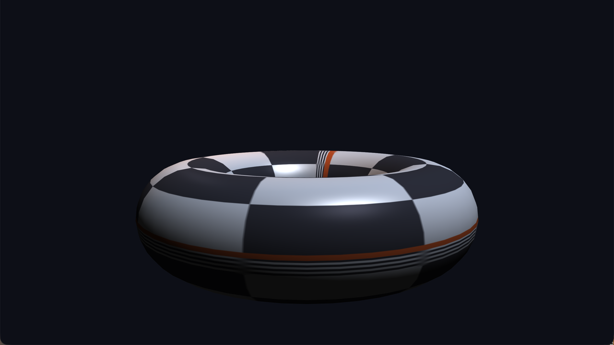
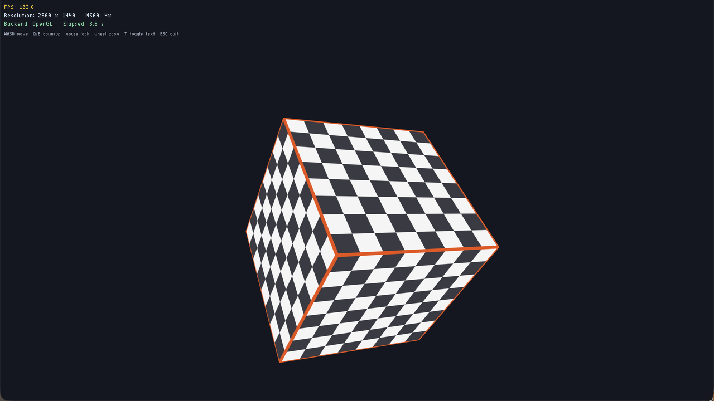
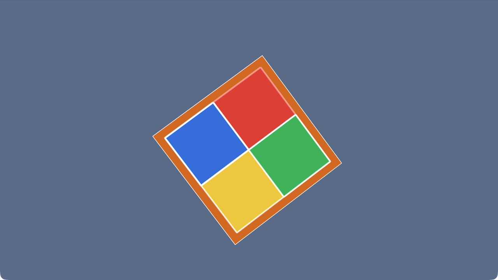
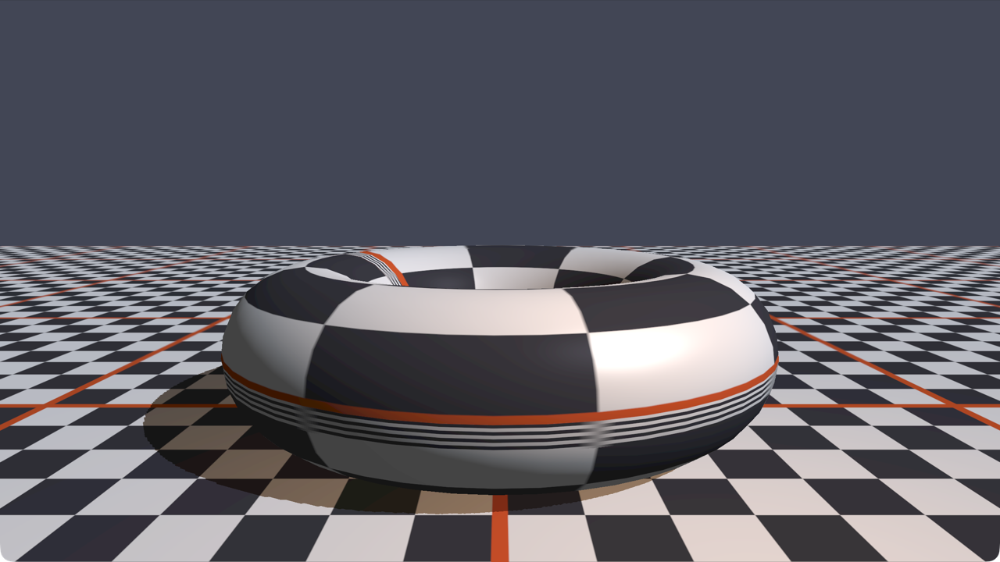
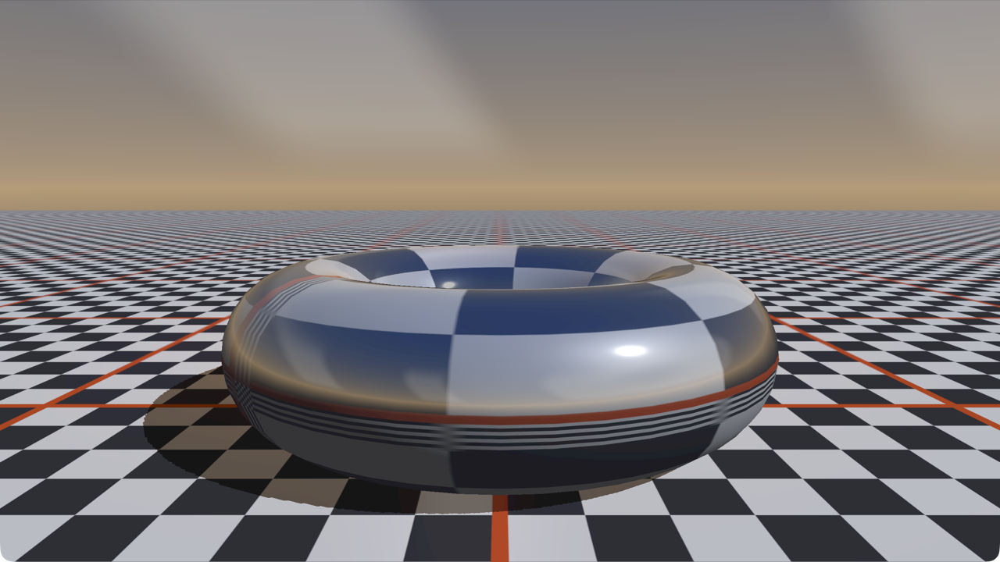
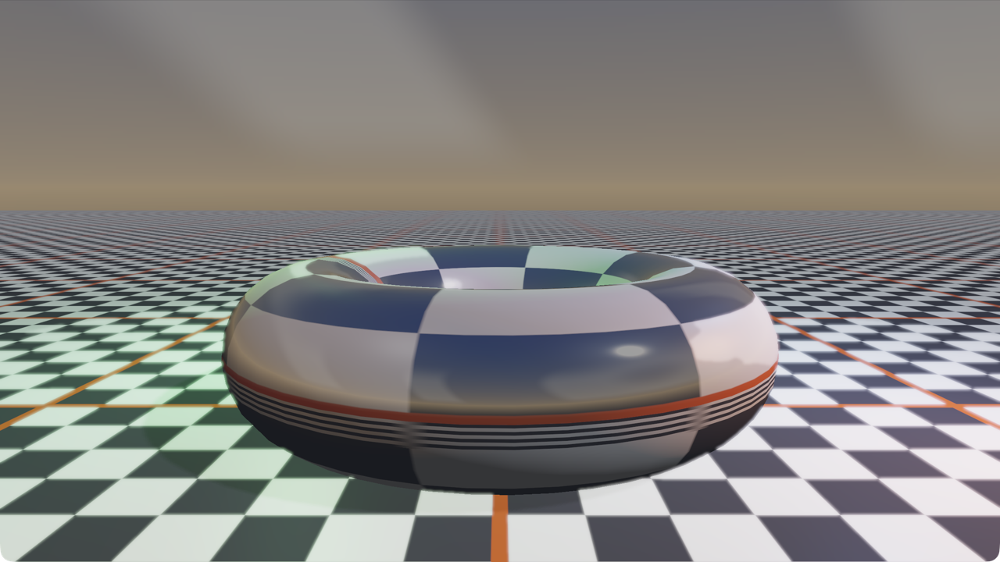
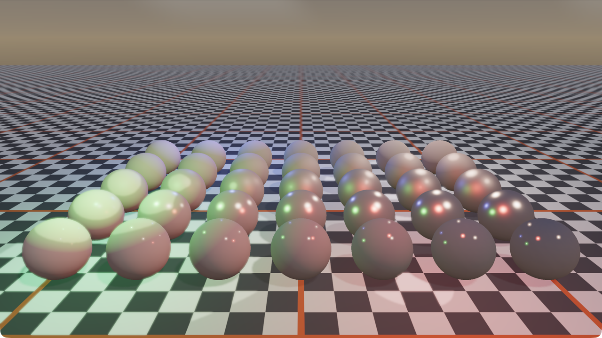
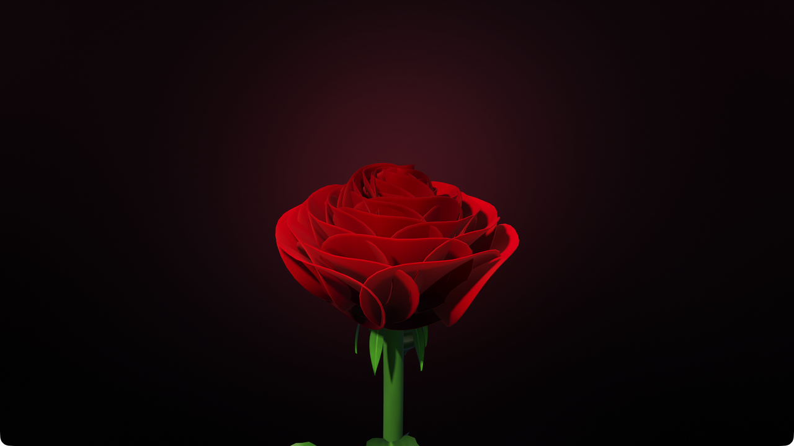

# Class-OpenGL-ES：现代 OpenGL ES C++ 封装引擎

[](LICENSE)

一个 C++17 / OpenGL ES 3.0（GLSL ES 3.00）的渲染引擎封装骨架，由
[Class-OpenGL](https://github.com/UnmetDecade/Class-OpenGL) 的桌面 OpenGL 3.3 Core 版本移植而来。
所有 GL 资源（program / buffer / VAO / texture / framebuffer）均由 RAII 类管理，拷贝被禁用、移动被保留；
所有 GL 调用经 `GLCall` 包裹，Debug 下出错立即打印 `文件:行号 调用语句 错误码` 并中断。

## 示例截图

> 以下截图为桌面 OpenGL 版本的参考渲染。ES 版本已在 Ubuntu 22.04 + Mesa llvmpipe
> 上逐个运行验证，画面一致（MSAA 采样数由 EGL 配置决定）。

**03_cube — 纹理立方体、深度测试与自由相机**


**05_lighting — OBJ 模型、材质、方向光 + 点光源与 Blinn-Phong 光照**



**06_text — 实时文字叠加层：FPS、分辨率、MSAA 与当前渲染后端**



**08_postprocess — 离屏场景 + 可组合后处理链（图为 Edge 效果）**



**09_shadow — 方向光阴影贴图 + PCF 软阴影**



**10_skybox — 立方体贴图天空盒与环境反射**



**11_hdr — RGBA16F HDR 场景、Reinhard 色调映射与 Bloom**



**12_pbr — Cook-Torrance PBR：7×5 metallic / roughness 球阵 + 多光源**



**13_rose — 程序化玫瑰：48 片黄金角螺旋花瓣（薄壳几何）、花萼/茎/叶/刺、方向光阴影与 ACES 色调映射**



## 功能概览

| 模块 | 文件 | 说明 |
|---|---|---|
| 窗口 | `engine/Window/Window.*` | GLFW 窗口/上下文、回调、VSync、MSAA |
| 错误检查 | `engine/Core/GLCall.h` | Debug 下包裹全部 GL 调用 |
| 着色器 | `engine/Renderer/Shader.*` | 文件/源码构造、编译链接报错、uniform 缓存 |
| 缓冲/VAO | `Buffer.*`、`VertexArray.*` | VBO/EBO/VAO 的 RAII 封装 |
| 纹理 | `Texture.*` | stb_image、自动 RGB/RGBA、mipmap、Y 翻转、sRGB 内部格式 |
| 立方体贴图 | `Cubemap.*` | 六面图上传、sRGB 内部格式、`Bind/Unbind` |
| 相机 | `Camera.*` | yaw/pitch、WASD、Q/E 升降、滚轮缩放 |
| 渲染命令 | `Renderer.*`、`RenderCommand.*` | 运行时多后端分发、绘制统计 |
| 后端 | `RendererAPI.h`、`OpenGLRendererAPI.*`、`NullRendererAPI.*` | OpenGL 实际后端 + Null 无头后端 |
| 光照/材质 | `Lighting.h` | Blinn-Phong、Material、方向光、点光 |
| PBR 材质 | `MaterialPBR.h` | albedo / metallic / roughness / AO，`Apply(Shader&)` |
| 网格/模型 | `Mesh.*`、`Model.*` | 索引网格、Wavefront OBJ 导入、UV 球体生成 |
| 文字 | `TextRenderer.*` | stb_easy_font 屏幕空间 ASCII 叠加层 |
| Shader 库 | `ShaderLibrary.*` | 单文件 `#type vertex` / `#type fragment` 管理 |
| 离屏渲染 | `Framebuffer.*` | 颜色附件 + 深度/模板 renderbuffer，支持 RGB8 / sRGB8 / RGBA16F |
| 后处理 | `PostProcess.*`、`PostEffect.h` | 场景 FBO、ping-pong 链、效果启用/排序、输出变换 |
| 阴影贴图 | `ShadowMap.*` | 2048² 深度 FBO、正交光空间矩阵、PCF 与 bias |
| HDR / Bloom | `hdr_output.frag`、`hdr_bright.frag`、`hdr_blur.frag` | RGBA16F、Reinhard、半分辨率可分离高斯 Bloom |
| PBR 着色 | `pbr.vert`、`pbr.frag` | Cook-Torrance GGX / Smith / Schlick，多光源，漫反射 IBL |
| 天空盒 | `skybox.vert`、`skybox.frag`、`lighting_shadow_reflect.frag` | 环境贴图、反射/折射、可选辐照度环境光 |

## 项目结构

```text
Class-OpenGL-ES/
├── CMakeLists.txt
├── ARCHITECTURE.md
├── engine/
│   ├── Core/              # Log / GLCall
│   ├── Window/            # GLFW 窗口与输入封装（ES 上下文）
│   ├── Renderer/          # Shader / Buffer / VAO / Texture / Cubemap / Framebuffer
│   │                      # PostProcess / ShadowMap / Camera / Lighting / PBR ...
│   └── examples/          # 01_triangle ... 13_rose
├── assets/
│   ├── shaders/           # GLSL ES 300 与 .glsl 单文件 shader
│   ├── models/            # torus.obj
│   ├── textures/          # skybox / irradiance 立方体贴图六面
│   └── *.png / *.jpg      # 测试纹理
├── third_party/
│   ├── glad/              # 预生成的 OpenGL ES 3.0 loader（glad2, gles2）
│   └── stb/               # stb_image / stb_easy_font
├── glfw/                  # 可选：本地 GLFW 源码（已 gitignore）
├── glm/                   # 可选：本地 glm 源码（已 gitignore）
└── docs/images/           # README 截图
```

## 构建

依赖：CMake ≥ 3.16、C++17 编译器。GLFW 3.4 与 glm 1.0.1 默认通过 FetchContent
获取；如果本地已经存在 `glfw/` 或 `glm/` 源码目录（两者都在 `.gitignore` 中），
CMake 会优先 `add_subdirectory` 使用本地副本，离线环境可这样构建。
`third_party/glad` 是预生成的 ES 3.0 loader，无需联网生成。

Ubuntu 22.04 上先装好 X11 开发包（GLFW 编译需要）：

```bash
sudo apt install build-essential cmake \
    libx11-dev libxrandr-dev libxinerama-dev libxcursor-dev libxi-dev libxext-dev
```

```bash
cd Class-OpenGL-ES
cmake -S . -B build -DCMAKE_BUILD_TYPE=Debug
cmake --build build -j
```

Release 构建（关闭 GLCall 检查）：

```bash
cmake -S . -B build-release -DCMAKE_BUILD_TYPE=Release
cmake --build build-release -j
```

资源目录通过编译定义 `ASSET_DIR` 指向项目的 `assets/`，无需复制可执行文件。

### 运行

GLFW 在 Linux 上默认优先 Wayland，找不到合成器时回退 X11。若需要强制某个后端
（例如在 Wayland 桌面下用 `xwd` 截取 X11 窗口），设置环境变量：

```bash
CLASS_OPENGL_GLFW_PLATFORM=x11 ./build/09_shadow
CLASS_OPENGL_GLFW_PLATFORM=wayland ./build/09_shadow
```

## OpenGL ES 3.0 移植说明

与桌面版本相比，ES 版本的主要改动集中在以下几处：

| 位置 | 改动 |
|---|---|
| `Window.cpp` | 上下文改为 `GLFW_CLIENT_API = GLFW_OPENGL_ES_API`、3.0；Linux 下由 EGL 创建。ES 没有 `GL_MULTISAMPLE` 开关，MSAA 由 EGL 配置决定，启动后查询 `GL_SAMPLES` 得到实际采样数 |
| `Shader.cpp` | `gladLoadGLES2` / `<glad/gles2.h>`；编译前把 `#version 330 core` 自动替换为 `#version 300 es` 并注入 `precision highp float/int`，因此 shader 源文件仍保持桌面版写法 |
| `assets/shaders/*` | 删除所有 uniform 初始化器（GLSL ES 3.00 不允许）；`post_edge.frag` 中未被宿主修改的 `u_Strength` 改为编译期常量 |
| `Texture.cpp` | 始终解码为 4 通道并使用 `GL_SRGB8_ALPHA8`；Mesa 的 ES 实现对 3 通道 `GL_SRGB8` 调用 `glGenerateMipmap` 会返回 `GL_INVALID_OPERATION` |
| `Framebuffer.cpp` | ES 3.0 没有 `GL_FRAMEBUFFER_INCOMPLETE_DRAW_BUFFER/READ_BUFFER` 枚举，按 `#ifdef` 保护；`RGBA16F` 需要 `GL_EXT_color_buffer_float`，不支持时输出警告并回退到 `GL_RGBA8` |
| `ShadowMap.cpp` | 深度纹理使用 `GL_DEPTH_COMPONENT24` + `GL_UNSIGNED_INT`；ES 没有 `GL_CLAMP_TO_BORDER`，改用 `GL_CLAMP_TO_EDGE`，越界片元在 shader 里显式判定为受光；`glDrawBuffers(GL_NONE)` 代替单参数 `glDrawBuffer` |

`TEXTURE_BORDER_COLOR`、`GL_RGB` 内部格式等桌面专有路径也做了相应替换。

## 在 Ubuntu 22.04 上验证

测试机为 Ubuntu 22.04 + ThinkCentre，Mesa llvmpipe 软件渲染（无独显），
`GL_VERSION = OpenGL ES 3.2 Mesa 23.2.1`，EGL 配置给出的 MSAA 为 4x。

```bash
cmake -S . -B build -DCMAKE_BUILD_TYPE=Debug
cmake --build build -j
DISPLAY=:0 ./build/09_shadow
```

13 个示例全部编译通过，Debug 版（`GLCall` 出错即中断）逐个运行无 GL 错误。
截图验证覆盖 01–13；软件渲染下 `13_rose`（约 20 万三角形 + MSAA）首帧需要
数秒，截图前应等待 8 秒以上。

## 示例

| 可执行文件 | 内容 | 操作 |
|---|---|---|
| `01_triangle` | 硬编码 GLSL 三角形，颜色随时间插值 | ESC 退出 |
| `02_texture` | EBO 矩形 + container 贴图 | ESC 退出 |
| `03_cube` | 旋转纹理立方体、深度测试 | WASD、Q/E、鼠标、滚轮、ESC |
| `04_shader_library` | ShaderLibrary + RenderCommand | ESC 退出 |
| `05_lighting` | OBJ torus、棋盘贴图、Material、方向光 + 点光、MSAA | WASD、Q/E、鼠标、滚轮、ESC |
| `06_text` | 3D 场景 + 实时文字叠加层（FPS/分辨率/MSAA/后端） | WASD、Q/E、鼠标、滚轮、T 隐藏文字、ESC |
| `07_backend_switch` | 运行时 OpenGL ↔ Null 后端切换与绘制统计 | B 切换后端、P 打印统计、ESC 退出 |
| `08_postprocess` | 场景渲染到离屏 FBO，经 Gray / Invert / Blur / Edge 后处理链，再由 `hdr_output.frag` 做最终输出 | 1 无 / 2 Gray / 3 Invert / 4 Edge / 5 Blur / 6 Gray+Edge、WASD/QE、鼠标、ESC |
| `09_shadow` | 方向光阴影贴图（正交光空间、PCF 3×3、bias 缩放），场景先写入离屏 FBO 再统一输出 | WASD/QE、鼠标、滚轮、`[` `]` bias、F6 PCF、ESC |
| `10_skybox` | 立方体贴图天空盒 + 环境反射/折射 + 方向光阴影，最终经 `hdr_output.frag` 输出 | WASD/QE、鼠标、1–6 后处理、F6 PCF、F7 折射、`-` `=` 反射率、ESC |
| `11_hdr` | RGBA16F 场景、Reinhard 色调映射、半分辨率 Bloom，可切换 HDR/LDR | F8 HDR/LDR、F9 Bloom、1–6 后处理、F6 PCF、F7 折射、`[` `]`、ESC |
| `12_pbr` | Cook-Torrance PBR，1 方向光 + 4 点光，7×5 metallic/roughness 球阵，漫反射 IBL | 1–6 后处理、L Lambert-only、F6 点光旋转暂停、F7 IBL、F8 HDR/LDR、F9 Bloom、`[` `]` bias、ESC |
| `13_rose` | 程序化玫瑰：黄金角螺旋排布的 48 片带厚度花瓣、花萼/茎/叶/刺、方向光阴影贴图、ACES 色调映射 | WASD/QE、按住左键或 Tab 锁定视角、滚轮、SPACE 转台、1–4 配色、ESC |

运行：

```bash
./build/01_triangle
./build/02_texture
./build/03_cube
./build/04_shader_library
./build/05_lighting
./build/06_text
./build/07_backend_switch
./build/08_postprocess
./build/09_shadow
./build/10_skybox
./build/11_hdr
./build/12_pbr
./build/13_rose
```

## 新增能力说明

### MSAA

`Window` 构造函数新增 `int msaaSamples = 4` 参数，`<= 0` 关闭。创建窗口时设置
`GLFW_SAMPLES`，上下文就绪后启用 `GL_MULTISAMPLE`，并通过 `GL_SAMPLES` 查询实际采样数，
`GetMSAASamples()` 返回该值（驱动可能降级）。

### 相机缩放与升降

`CameraMovement` 新增 `Up` / `Down`；`ProcessMouseScroll(float)` 把 FOV 限制在 `[1°, 45°]`，
`GetZoom()` 读取当前 FOV。`Window` 新增 `SetScrollCallback`。

### 光照与材质

`Lighting.h` 提供三个值类型：

- `Material`：ambient / diffuse / specular / shininess，`Apply(Shader&)`
- `DirectionalLight`：方向、三种颜色，`Apply(Shader&)`
- `PointLight`：位置、距离衰减系数、三种颜色，`Apply(Shader&)`

`assets/shaders/lighting.vert/.frag` 使用 Blinn-Phong，支持法线矩阵、方向光、点光与漫反射贴图。

### 模型导入

`Model` 解析 Wavefront OBJ 的 `v` / `vt` / `vn` / `f`：

- 多边形按扇形三角化
- 支持负索引
- 缺省法线时按面积加权计算平滑法线
- 每个 `Model` 持有一个或多个 `Mesh`

明确不解析 `.mtl`、纹理引用、材质组与骨骼动画。

### 文字

`TextRenderer::Draw(text, x, y, scale, color, viewportWidth, viewportHeight)`：

- 使用 `stb_easy_font`，ASCII 点阵四边形，无需外部字体文件
- y 轴向下的屏幕空间正交投影，坐标为像素
- 绘制时临时关闭深度测试，结束后恢复
- 顶点为 `(vec3 pos, vec4 color)`，动态上传

### 运行时多后端

`Renderer` 内部持有 `std::unique_ptr<RendererAPI>`，`SetBackend(RendererBackend::OpenGL / Null)`
可在运行中切换；`GetStats()` 返回当前后端的 clear/draw/index/vertex 计数，
切换时旧后端统计会写入日志。

- **OpenGL 后端**：真实执行 GL 命令，所有调用仍经 `GLCall`
- **Null 后端**：不发出任何 GL 命令，只校验资源句柄并累计统计，用于无头/基准路径验证

这是**命令级**后端抽象：VAO/VBO/Texture 等资源类仍由 OpenGL 具体类型持有；
若要支持 Vulkan/Metal，需要再抽象一层 GPU 资源接口。示例 `07_backend_switch` 演示运行时切换。

### 离屏渲染与后处理

`Framebuffer(width, height, hdr, sRGBColorSpace)` 创建一个颜色纹理附件 + 深度/模板
renderbuffer；颜色格式按参数选择 `GL_RGB8`、`GL_SRGB8` 或 `GL_RGBA16F`，移动赋值会先释放
旧附件。`Resize()` 重建附件，`GetColorAttachmentID()` 返回可供采样的颜色纹理。

`PostProcess` 封装「场景 FBO → 效果链 ping-pong → 最终纹理」：

- `BeginScene()` / `EndScene()` 绑定与解绑场景 FBO
- `AddEffect(name, shader)` 按添加顺序执行；`SetEffectEnabled(name, bool)` 单独启停
- 每个效果由一个全屏三角/四边形 pass 完成，颜色在两张 ping-pong FBO 间交替
- `Render()` 返回效果链最后一张颜色纹理
- `SetHDRScene(bool)` 在 RGB8 与 RGBA16F 场景目标间切换
- `SetOutputTransform(shader, useHDR)` 记录最终输出阶段使用的 shader 与 `u_UseHDR`

### 阴影贴图

`ShadowMap(resolution)` 建立只含深度附件的 FBO（默认 2048²），`GetDepthTexture()` 提供给
光照 shader 采样。示例中的做法：

- 用方向光方向构造正交光空间矩阵 `projection * lookAt`
- `BeginWrite(matrix)` 只清深度并绘制所有投影体
- `EndWrite(w, h)` 恢复默认帧缓冲与视口
- 光照 shader 中比较当前片元与阴影贴图深度；`u_BiasScale` 控制偏移，`u_UsePCF` 开启 3×3
  PCF。阴影因子只作用于方向光的直接光照，点光与 ambient 不受影响

### HDR 与色调映射

**sRGB 纹理约定**：`Texture` 与 `Cubemap` 上传时使用 `GL_SRGB8` / `GL_SRGB8_ALPHA8`
内部格式。GPU 在采样时自动解码到线性空间，因此光照计算全部在线性空间进行；
渲染目标与默认帧缓冲都是线性 8 位格式，**不会**自动编码。

**HDR 场景**：`Framebuffer(hdr=true)` 使用 `GL_RGBA16F`，保留大于 1.0 的高光值；
`PostProcess::SetHDRScene(true)` 会把场景与 ping-pong 目标一起切到 RGBA16F。

**单次 gamma 编码**：最终输出统一经过 `assets/shaders/hdr_output.frag`：

1. HDR 路径（`u_UseHDR = 1`）：可选叠加 Bloom → Reinhard `c / (c + 1)` 压缩 → `pow(1/2.2)`；
2. LDR 直通路径（`u_UseHDR = 0`）：默认原样输出；`u_EncodeLDR = 1` 时执行同样的
   `pow(1/2.2)` 编码，供没有 HDR 链的旧示例（08/09/10）把线性场景目标转换到显示空间。

整帧只有这一处 `pow(1/2.2)`，避免重复编码导致画面发灰。

**Bloom**：`hdr_bright.frag` 以阈值 1.0 提取亮部并输出到半分辨率目标，
`hdr_blur.frag` 做 9 次采样的可分离高斯模糊（先水平后垂直），
`hdr_output.frag` 在色调映射前按 `u_BloomStrength` 叠加。

### PBR 与 IBL

`assets/shaders/pbr.frag` 实现 Cook-Torrance 直接光照：

- **D**：Trowbridge-Reitz / GGX 法线分布
- **G**：Smith 几何项，Schlick-GGX 近似，`k = (roughness + 1)² / 8`
- **F**：Schlick Fresnel
- `kS = F`，`kD = (1 - kS) * (1 - metallic)`，`F0 = mix(0.04, albedo, metallic)`

多光源在同一次 pass 内累加：1 个方向光 + 最多 8 个点光。点光使用平方反比衰减，并乘上
`(1 - (d / radius)⁴)²` 的平滑截断窗，避免半径边缘硬切。阴影因子只乘到方向光项。

环境项默认为常量 `u_AmbientColor`；开启 `u_UseIBL` 时改为采样漫反射辐照度立方体贴图
`u_IrradianceMap`（`texture(u_IrradianceMap, N)`）。该贴图为 32×32×6、从天空盒按余弦加权
半球积分预计算，保存在 `assets/textures/irradiance/`，运行时不需要计算。

`12_pbr` 生成 7 列 × 5 行的 UV 球阵：列方向 metallic 从 0 递增到 1，行方向 roughness 从
0.05 递增到 1，可直观看到高光由锐利到粗糙、金属反射由暗到亮的过渡。

### 程序化玫瑰（13_rose）

`13_rose` 的所有几何都由参数曲面在启动时生成，不使用任何模型或贴图：

- **花瓣**：每片花瓣是一个椭圆轮廓的参数曲面，按 137.5° 黄金角螺旋排列 48 片，越靠外越大、
  外倾越多、尖端越下垂，形成层层交叠的花瓣。花瓣不是零厚度薄片，而是沿法线偏移出正反两层
  并封住边缘的**薄壳**，因此边缘有圆润的高光带，不会在转折处出现“折纸”硬边。
- **花心**：内层花瓣更小、杯曲更深，向中心卷拢；中央另有一个椭球花蕾，避免花心变成黑洞。
- **光照**：2048² 方向光阴影贴图（5×5 PCF + 斜率偏置）让层叠花瓣之间产生真实遮挡；
  花瓣使用 wrap diffuse、菲涅尔边缘光、带色高光与背面透光近似，最后经 ACES 色调映射输出。
- **按键**：默认不锁定鼠标，**按住左键拖动**即可环视；`Tab` 在“自由光标 / 锁定环视”之间切换；
  `1`–`4` 切换 Crimson / Blush / Ivory / Burgundy 配色，`SPACE` 开关转台。

## 自检清单

- [x] 所有 GL 对象析构释放：Shader、VBO、EBO、VAO、Texture、Cubemap、Framebuffer、
      ShadowMap、TextRenderer 均实现析构
- [x] 拷贝构造/赋值已 `= delete`，移动构造/赋值保留（Window/Shader/Buffer/VAO/Texture/
      Cubemap/Framebuffer/ShadowMap/Mesh/Model/TextRenderer）
- [x] 移动赋值先释放旧 GL 附件再接管新句柄，不产生泄漏（Framebuffer / ShadowMap）
- [x] 着色器编译/链接失败抛出 `std::runtime_error`，包含 VERTEX/FRAGMENT/LINK 与完整 info log
- [x] 全部 GL 调用经 `GLCall`（引擎模块与 13 个示例一致）
- [x] sRGB 纹理只在采样时解码一次，整帧只在 `hdr_output.frag` 做一次线性 → sRGB 编码
- [x] 场景 FBO / ping-pong FBO / 阴影 FBO 尺寸变化时正确重建（`Resize` 回调）
- [x] 多后端切换会记录旧后端统计并重新初始化新后端
- [x] Debug 全量构建（`-Wall -Wextra`）引擎与示例零警告
- [x] 示例 01–13 在 macOS 上全部启动、运行、键位响应正常，无 GL 错误、无 "Uniform not found"
- [x] 08/09/10 补最终输出 pass 后观感恢复；11/12 代码零改动、行为不变
- [x] 13 的薄壳花瓣、阴影、换色与转台在 Apple M4 上运行正常

## 验证记录

- **macOS（Apple M4，OpenGL 4.1 Metal，MSAA 4x）**：最终验收中逐项运行 01–13。
  01/02/04 画面与贴图正常；03 立方体旋转与相机漫游正常；05 光照/材质/点光与阶段 11 前一致；
  06 文字叠加层显示 FPS/分辨率/MSAA/后端；07 用模拟按键验证 `OpenGL → Null → OpenGL` 切换与统计；
  08 的 1–6 效果切换全部生效，默认直通画面亮度正常；09 的 `[` `]` bias 与 F6 PCF 生效，
  黑白棋盘对比度恢复；10 天空盒无接缝、反射/折射与后处理键位正常，天空亮度与灰蓝/暖色
  层次恢复（与阶段 10 验收截图一致）；11 的 F8 HDR/LDR、F9 Bloom 与 1–6 后处理正常；
  12 的球阵、多光源、L/F6/F7/F8/F9 全部正常；13 的玫瑰渲染、1–4 配色切换与
  SPACE 转台正常。运行期间无 `GL_INVALID_*` 中断，无 "Uniform not found" 警告。
- **Ubuntu 22.04.5（GCC 11.4.0，Xwayland + Mesa 23.2.1 llvmpipe / LLVM 15.0.7，
  OpenGL 4.5 Core，MSAA 4x）**：最终验收实机复跑，01–12 全部 Debug 构建通过并逐个启动
  运行，日志无 `GL_INVALID_*` 中断、无 "Uniform not found"；01–07 沿用前序阶段的画面
  验证，08–12 本次逐一截图核对：08 默认直通立方体、09 黑白棋盘高对比 + 投影、10 天空盒
  + 环面环境反射、11 HDR/Bloom、12 PBR 金属/粗糙度球阵与多光源，结果与 macOS 一致。
  键位路径已在 macOS 逐项验证；Ubuntu 未安装 xdotool，未做按键注入。
  构建中发现 GCC 拒绝与类型同名的成员（`EffectEntry::Shader`），已将成员重命名为
  `Program`（纯重命名，行为不变），macOS 侧改后重新构建并复跑 08/10/11/12 正常。
  注：GLFW 3.4 在 Wayland 会话下默认创建原生 Wayland 窗口，截图时以
  `WAYLAND_DISPLAY=wayland-missing` 强制 X11/Xwayland 以便 `xwininfo` / `xwd` 定位窗口。

## 明确未实现

**渲染技术**

- 法线贴图 / 切线空间、各向异性、clearcoat
- 镜面 IBL（预滤波环境贴图 + BRDF LUT）
- 点光源阴影（cube shadow map）、CSM 级联、VSM/EVSM、自阴影优化（正面剔除 / normal offset）
- 曝光自适应、ACES/Filmic tonemap、Bloom 软 knee 与更好模糊
- MSAA FBO resolve（场景 FBO 为单采样）、动态环境映射
- OBJ 的 `.mtl` 材质、外部贴图与多材质分组、骨骼动画

**工程**

- 资源管理器 / 热重载、场景图 / ECS、编辑器
- Null 后端不是 GPU 无关的资源抽象，仍依赖已创建的 OpenGL 句柄
- 文字叠加层直接使用 OpenGL 绘制（调试 UI），不经过 `RendererAPI`

**其他**

- 非 ASCII 文字、字体图集、文本换行与布局
- 音频、物理
- 未引入 boost / Qt / assimp 等约定外第三方库

## 第三方组件

项目使用 GLFW、glm、glad、stb 等第三方库；各库许可证见其源码目录或文件头。

## License

本项目采用 [MIT License](LICENSE) 发布。
