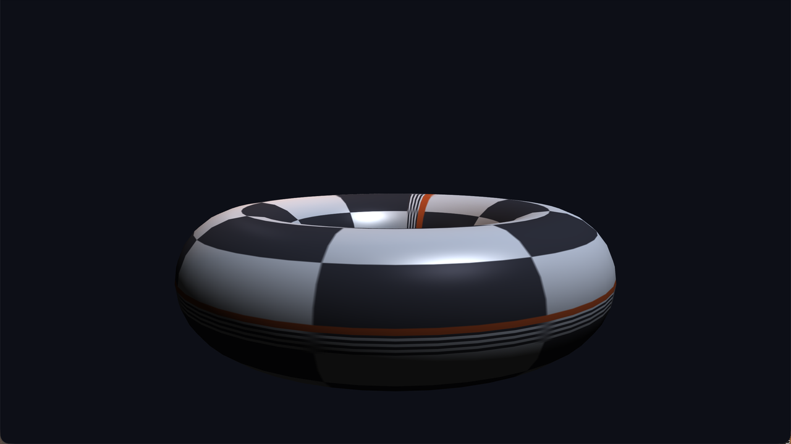
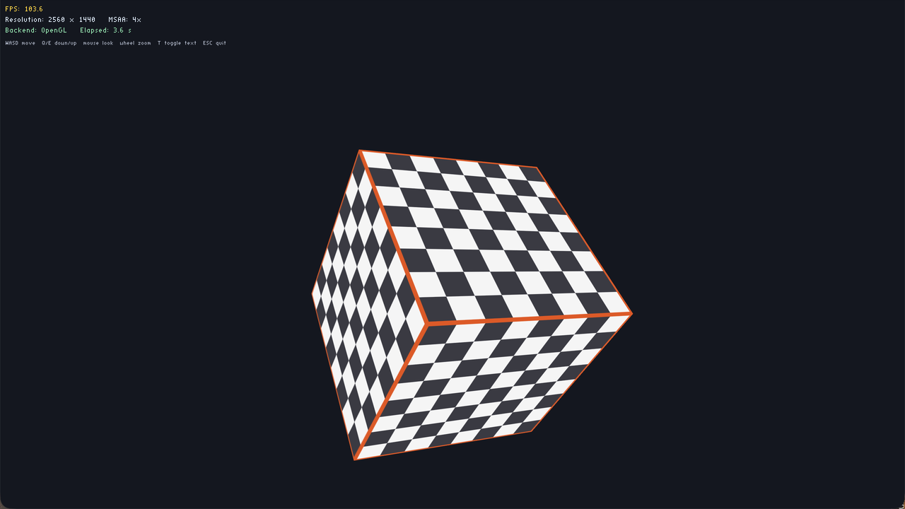
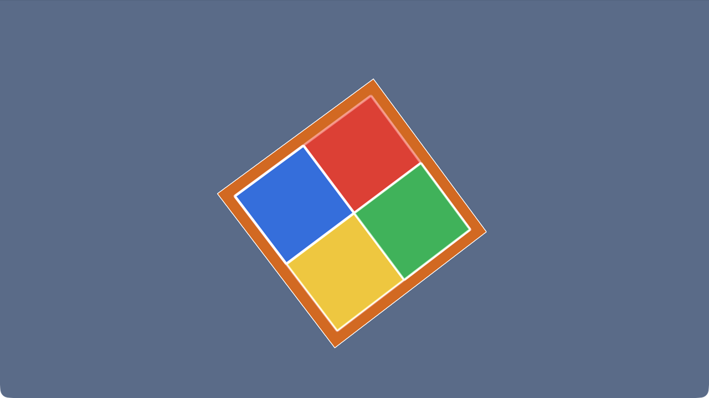
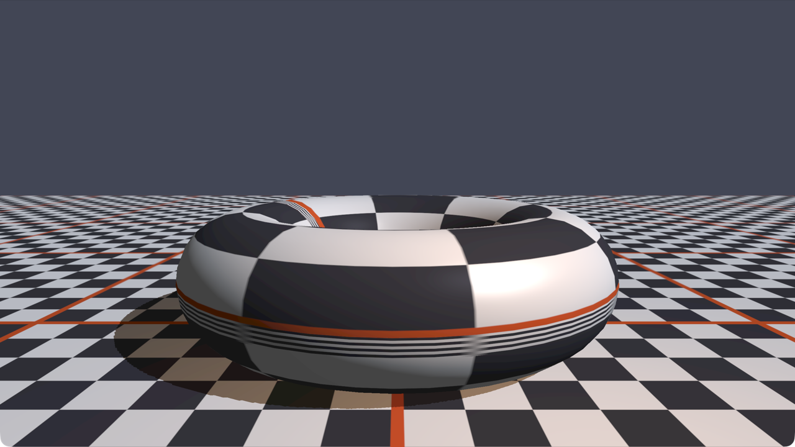
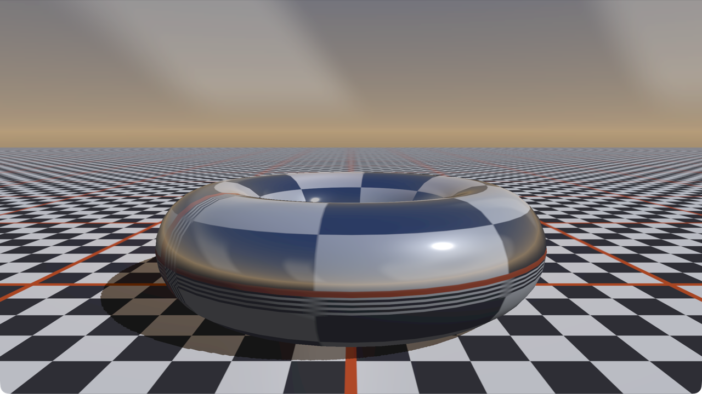
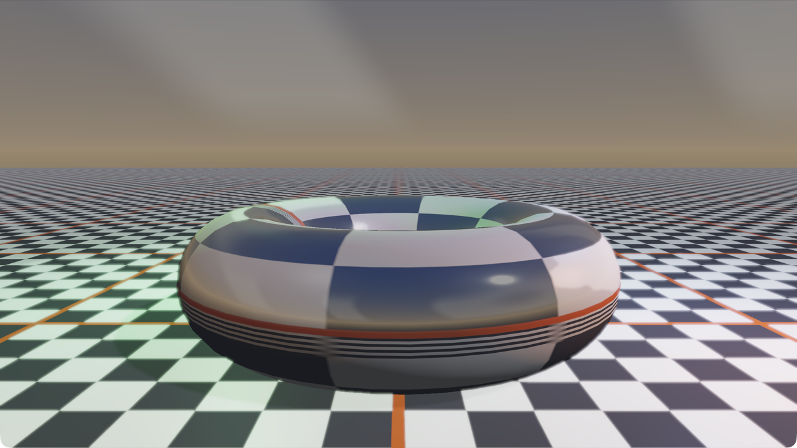
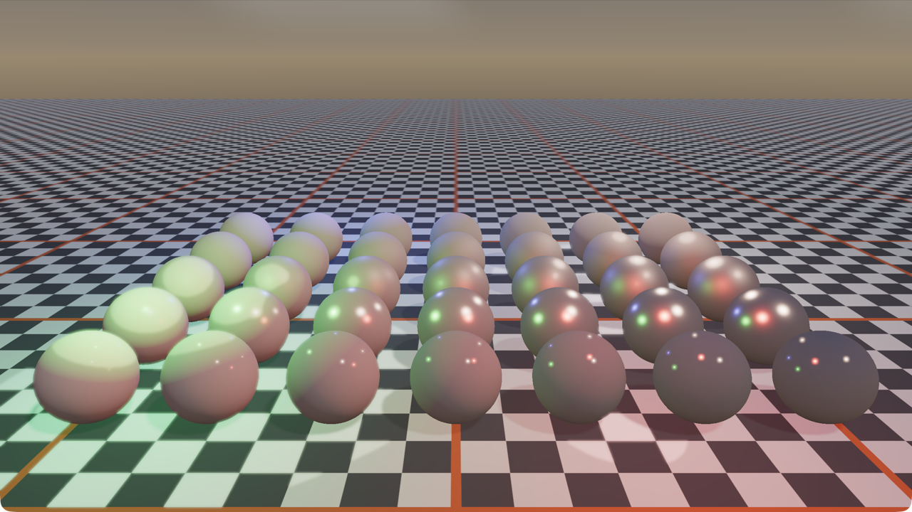
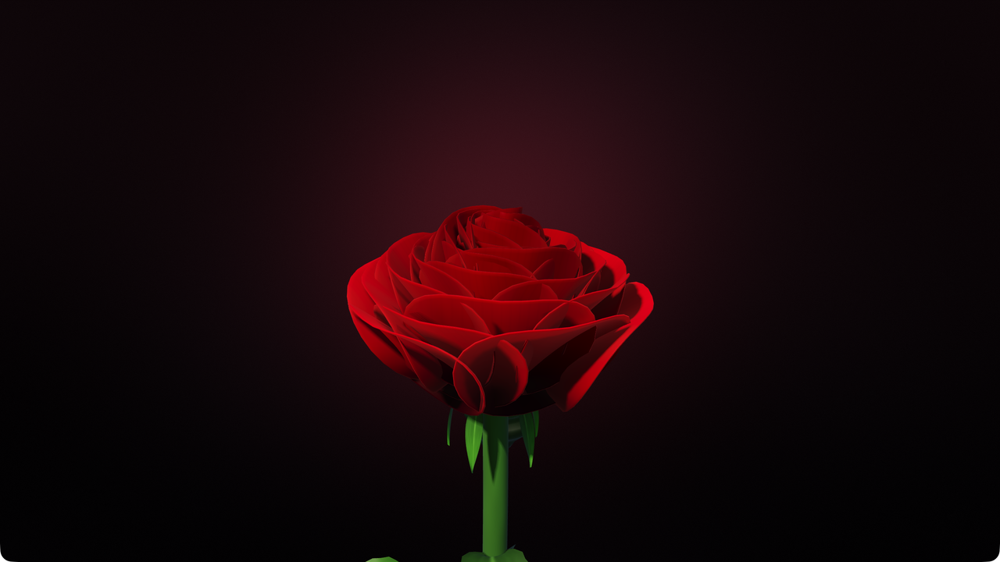

# Class-OpenGL-ES: A Modern OpenGL ES C++ Wrapper Engine

<div align="left"><b>English</b> · <a href="README.zh-CN.md">简体中文</a></div>

[](LICENSE)

A C++17 / OpenGL ES 3.0 (GLSL ES 3.00) rendering-engine wrapper skeleton, ported from
the desktop OpenGL 3.3 Core version of
[Class-OpenGL](https://github.com/UnmetDecade/Class-OpenGL).
Every GL resource (program / buffer / VAO / texture / framebuffer) is managed by an RAII class:
copying is deleted and moving is allowed. Every GL call is wrapped in `GLCall`, which in Debug
builds prints `file:line call error-code` and aborts the moment an error occurs.

## Sample Screenshots

> The screenshots below are reference renders from the desktop OpenGL version. The ES version
> has been run one by one on Ubuntu 22.04 + Mesa llvmpipe, and the images match (the MSAA sample
> count is determined by the EGL config).

**03_cube — textured cube, depth testing and a free camera**


**05_lighting — OBJ model, materials, directional + point lights and Blinn-Phong shading**



**06_text — real-time text overlay: FPS, resolution, MSAA and the active rendering backend**



**08_postprocess — offscreen scene + composable post-processing chain (Edge effect shown)**



**09_shadow — directional-light shadow map + PCF soft shadows**



**10_skybox — cubemap skybox and environment reflections**



**11_hdr — RGBA16F HDR scene, Reinhard tone mapping and Bloom**



**12_pbr — Cook-Torrance PBR: 7×5 metallic / roughness sphere grid + multiple lights**



**13_rose — procedural rose: 48 petals on a golden-angle spiral (thin-shell geometry), calyx/stem/leaves/thorns, directional-light shadows and ACES tone mapping**



## Feature Overview

| Module | Files | Description |
|---|---|---|
| Window | `engine/Window/Window.*` | GLFW window/context, callbacks, VSync, MSAA |
| Error checking | `engine/Core/GLCall.h` | Wraps every GL call in Debug builds |
| Shader | `engine/Renderer/Shader.*` | Construction from file/source, compile and link errors, uniform cache |
| Buffer/VAO | `Buffer.*`, `VertexArray.*` | RAII wrappers for VBO/EBO/VAO |
| Texture | `Texture.*` | stb_image, automatic RGB/RGBA, mipmaps, Y flip, sRGB internal format |
| Cubemap | `Cubemap.*` | Six-face upload, sRGB internal format, `Bind/Unbind` |
| Camera | `Camera.*` | yaw/pitch, WASD, Q/E up/down, scroll zoom |
| Render commands | `Renderer.*`, `RenderCommand.*` | Runtime multi-backend dispatch, draw statistics |
| Backends | `RendererAPI.h`, `OpenGLRendererAPI.*`, `NullRendererAPI.*` | Real OpenGL backend + headless Null backend |
| Lighting/materials | `Lighting.h` | Blinn-Phong, Material, directional light, point light |
| PBR material | `MaterialPBR.h` | albedo / metallic / roughness / AO, `Apply(Shader&)` |
| Mesh/model | `Mesh.*`, `Model.*` | Indexed meshes, Wavefront OBJ import, UV sphere generation |
| Text | `TextRenderer.*` | stb_easy_font screen-space ASCII overlay |
| Shader library | `ShaderLibrary.*` | Single-file `#type vertex` / `#type fragment` management |
| Offscreen rendering | `Framebuffer.*` | Color attachment + depth/stencil renderbuffer, supports RGB8 / sRGB8 / RGBA16F |
| Post-processing | `PostProcess.*`, `PostEffect.h` | Scene FBO, ping-pong chain, effect enable/ordering, output transform |
| Shadow map | `ShadowMap.*` | 2048² depth FBO, orthographic light-space matrix, PCF and bias |
| HDR / Bloom | `hdr_output.frag`, `hdr_bright.frag`, `hdr_blur.frag` | RGBA16F, Reinhard, half-resolution separable Gaussian Bloom |
| PBR shading | `pbr.vert`, `pbr.frag` | Cook-Torrance GGX / Smith / Schlick, multiple lights, diffuse IBL |
| Skybox | `skybox.vert`, `skybox.frag`, `lighting_shadow_reflect.frag` | Environment map, reflection/refraction, optional irradiance ambient |

## Project Structure

```text
Class-OpenGL-ES/
├── CMakeLists.txt
├── ARCHITECTURE.md
├── engine/
│   ├── Core/              # Log / GLCall
│   ├── Window/            # GLFW window and input wrappers (ES context)
│   ├── Renderer/          # Shader / Buffer / VAO / Texture / Cubemap / Framebuffer
│   │                      # PostProcess / ShadowMap / Camera / Lighting / PBR ...
│   └── examples/          # 01_triangle ... 13_rose
├── assets/
│   ├── shaders/           # GLSL ES 300 and single-file .glsl shaders
│   ├── models/            # torus.obj
│   ├── textures/          # skybox / irradiance cubemap faces
│   └── *.png / *.jpg      # test textures
├── third_party/
│   ├── glad/              # pre-generated OpenGL ES 3.0 loader (glad2, gles2)
│   └── stb/               # stb_image / stb_easy_font
├── glfw/                  # optional: local GLFW sources (gitignored)
├── glm/                   # optional: local glm sources (gitignored)
└── docs/images/           # README screenshots
```

## Build

Dependencies: CMake ≥ 3.16 and a C++17 compiler. GLFW 3.4 and glm 1.0.1 are fetched through
FetchContent by default; if local `glfw/` or `glm/` source directories already exist (both are in
`.gitignore`), CMake prefers `add_subdirectory` and uses the local copies — that is how you build
in an offline environment. `third_party/glad` is a pre-generated ES 3.0 loader, so no network
generation is required.

On Ubuntu 22.04, install the X11 development packages first (needed to build GLFW):

```bash
sudo apt install build-essential cmake \
    libx11-dev libxrandr-dev libxinerama-dev libxcursor-dev libxi-dev libxext-dev
```

```bash
cd Class-OpenGL-ES
cmake -S . -B build -DCMAKE_BUILD_TYPE=Debug
cmake --build build -j
```

Release build (GLCall checks disabled):

```bash
cmake -S . -B build-release -DCMAKE_BUILD_TYPE=Release
cmake --build build-release -j
```

The asset directory is provided through the compile definition `ASSET_DIR`, which points at the
project's `assets/`, so the executable does not need to be copied.

### Running

On Linux, GLFW prefers Wayland by default and falls back to X11 when no compositor is found.
To force a particular backend (for example, to capture an X11 window with `xwd` from a Wayland
desktop), set the environment variable:

```bash
CLASS_OPENGL_GLFW_PLATFORM=x11 ./build/09_shadow
CLASS_OPENGL_GLFW_PLATFORM=wayland ./build/09_shadow
```

## OpenGL ES 3.0 Porting Notes

Compared with the desktop version, the ES version's changes are concentrated in the following
places:

| Location | Change |
|---|---|
| `Window.cpp` | Context switched to `GLFW_CLIENT_API = GLFW_OPENGL_ES_API`, 3.0; created through EGL on Linux. ES has no `GL_MULTISAMPLE` switch — MSAA is determined by the EGL config, and the actual sample count is queried through `GL_SAMPLES` after startup |
| `Shader.cpp` | `gladLoadGLES2` / `<glad/gles2.h>`; before compiling, `#version 330 core` is automatically replaced with `#version 300 es` and `precision highp float/int` is injected, so the shader source files keep their desktop form |
| `assets/shaders/*` | All uniform initializers removed (GLSL ES 3.00 does not allow them); the `u_Strength` in `post_edge.frag` that the host never modified is now a compile-time constant |
| `Texture.cpp` | Always decoded as 4 channels and using `GL_SRGB8_ALPHA8`; Mesa's ES implementation returns `GL_INVALID_OPERATION` from `glGenerateMipmap` on 3-channel `GL_SRGB8` |
| `Framebuffer.cpp` | ES 3.0 has no `GL_FRAMEBUFFER_INCOMPLETE_DRAW_BUFFER/READ_BUFFER` enums, so these are guarded with `#ifdef`; `RGBA16F` requires `GL_EXT_color_buffer_float`, and when unsupported it logs a warning and falls back to `GL_RGBA8` |
| `ShadowMap.cpp` | Depth texture uses `GL_DEPTH_COMPONENT24` + `GL_UNSIGNED_INT`; ES has no `GL_CLAMP_TO_BORDER`, so `GL_CLAMP_TO_EDGE` is used instead and out-of-range fragments are explicitly treated as lit in the shader; `glDrawBuffers(GL_NONE)` replaces the single-argument `glDrawBuffer` |

Other desktop-only paths such as `TEXTURE_BORDER_COLOR` and the internal format `GL_RGB` were
replaced accordingly.

## Verified on Ubuntu 22.04

The test machine is an Ubuntu 22.04 ThinkCentre with Mesa llvmpipe software rendering (no
discrete GPU), `GL_VERSION = OpenGL ES 3.2 Mesa 23.2.1`, and 4x MSAA from the EGL config.

```bash
cmake -S . -B build -DCMAKE_BUILD_TYPE=Debug
cmake --build build -j
DISPLAY=:0 ./build/09_shadow
```

All 13 examples compile, and each runs in the Debug build (which aborts on any `GLCall` error)
without GL errors. Screenshot verification covers 01–13; under software rendering the first frame
of `13_rose` (about 200k triangles + MSAA) takes several seconds, so wait at least 8 seconds
before taking a screenshot.

## Examples

| Executable | Contents | Controls |
|---|---|---|
| `01_triangle` | Hard-coded GLSL triangle, color interpolates over time | ESC to quit |
| `02_texture` | EBO rectangle + container texture | ESC to quit |
| `03_cube` | Rotating textured cube, depth testing | WASD, Q/E, mouse, scroll wheel, ESC |
| `04_shader_library` | ShaderLibrary + RenderCommand | ESC to quit |
| `05_lighting` | OBJ torus, checkerboard texture, Material, directional + point lights, MSAA | WASD, Q/E, mouse, scroll wheel, ESC |
| `06_text` | 3D scene + real-time text overlay (FPS/resolution/MSAA/backend) | WASD, Q/E, mouse, scroll wheel, T hides the text, ESC |
| `07_backend_switch` | Runtime OpenGL ↔ Null backend switching with draw statistics | B switches backend, P prints stats, ESC quits |
| `08_postprocess` | Scene rendered to an offscreen FBO, then through the Gray / Invert / Blur / Edge post-processing chain, with final output through `hdr_output.frag` | 1 none / 2 Gray / 3 Invert / 4 Edge / 5 Blur / 6 Gray+Edge, WASD/QE, mouse, ESC |
| `09_shadow` | Directional-light shadow map (orthographic light space, 3×3 PCF, scaled bias); the scene is first written to an offscreen FBO and then output uniformly | WASD/QE, mouse, scroll wheel, `[` `]` bias, F6 PCF, ESC |
| `10_skybox` | Cubemap skybox + environment reflection/refraction + directional-light shadows, with final output through `hdr_output.frag` | WASD/QE, mouse, 1–6 post-processing, F6 PCF, F7 refraction, `-` `=` reflectance, ESC |
| `11_hdr` | RGBA16F scene, Reinhard tone mapping, half-resolution Bloom, toggleable HDR/LDR | F8 HDR/LDR, F9 Bloom, 1–6 post-processing, F6 PCF, F7 refraction, `[` `]`, ESC |
| `12_pbr` | Cook-Torrance PBR, 1 directional light + 4 point lights, 7×5 metallic/roughness sphere grid, diffuse IBL | 1–6 post-processing, L Lambert-only, F6 pause point-light rotation, F7 IBL, F8 HDR/LDR, F9 Bloom, `[` `]` bias, ESC |
| `13_rose` | Procedural rose: 48 thick petals arranged on a golden-angle spiral, calyx/stem/leaves/thorns, directional-light shadow map, ACES tone mapping | WASD/QE, hold left mouse or Tab to lock the view, scroll wheel, SPACE turntable, 1–4 color schemes, ESC |

Run:

```bash
./build/01_triangle
./build/02_texture
./build/03_cube
./build/04_shader_library
./build/05_lighting
./build/06_text
./build/07_backend_switch
./build/08_postprocess
./build/09_shadow
./build/10_skybox
./build/11_hdr
./build/12_pbr
./build/13_rose
```

## New Capabilities

### MSAA

The `Window` constructor gains an `int msaaSamples = 4` parameter; `<= 0` disables it.
`GLFW_SAMPLES` is set when the window is created, `GL_MULTISAMPLE` is enabled once the context is
ready, and the actual sample count is queried through `GL_SAMPLES`; `GetMSAASamples()` returns
that value (the driver may downgrade it).

### Camera Zoom and Elevation

`CameraMovement` gains `Up` / `Down`; `ProcessMouseScroll(float)` clamps the FOV to `[1°, 45°]`,
and `GetZoom()` reads the current FOV. `Window` gains `SetScrollCallback`.

### Lighting and Materials

`Lighting.h` provides three value types:

- `Material`: ambient / diffuse / specular / shininess, `Apply(Shader&)`
- `DirectionalLight`: direction, three colors, `Apply(Shader&)`
- `PointLight`: position, distance attenuation coefficients, three colors, `Apply(Shader&)`

`assets/shaders/lighting.vert/.frag` use Blinn-Phong and support the normal matrix, directional
light, point lights and diffuse maps.

### Model Import

`Model` parses the `v` / `vt` / `vn` / `f` of a Wavefront OBJ:

- Polygons are triangulated as fans
- Negative indices are supported
- When normals are missing, smooth normals are computed with area weighting
- Each `Model` holds one or more `Mesh` objects

It deliberately does not parse `.mtl`, texture references, material groups or skeletal animation.

### Text

`TextRenderer::Draw(text, x, y, scale, color, viewportWidth, viewportHeight)`:

- Uses `stb_easy_font`, ASCII quad glyphs, no external font file needed
- Screen-space orthographic projection with y pointing down; coordinates are in pixels
- Depth testing is temporarily disabled while drawing and restored afterwards
- Vertices are `(vec3 pos, vec4 color)`, uploaded dynamically

### Runtime Multi-Backend

`Renderer` holds a `std::unique_ptr<RendererAPI>` internally, and
`SetBackend(RendererBackend::OpenGL / Null)` switches at runtime; `GetStats()` returns the current
backend's clear/draw/index/vertex counts, and on a switch the old backend's statistics are written
to the log.

- **OpenGL backend**: executes real GL commands; every call still goes through `GLCall`
- **Null backend**: issues no GL commands at all, only validates resource handles and accumulates statistics — used for headless/benchmark-path verification

This is a **command-level** backend abstraction: resource classes such as VAO/VBO/Texture are
still held by concrete OpenGL types; supporting Vulkan/Metal would require another layer of GPU
resource interfaces. The `07_backend_switch` example demonstrates runtime switching.

### Offscreen Rendering and Post-Processing

`Framebuffer(width, height, hdr, sRGBColorSpace)` creates a color texture attachment + depth/stencil
renderbuffer; the color format is selected from `GL_RGB8`, `GL_SRGB8` or `GL_RGBA16F` by the
parameters, and move assignment releases the old attachments first. `Resize()` rebuilds the
attachments, and `GetColorAttachmentID()` returns the color texture available for sampling.

`PostProcess` encapsulates "scene FBO → effect-chain ping-pong → final texture":

- `BeginScene()` / `EndScene()` bind and unbind the scene FBO
- `AddEffect(name, shader)` runs effects in the order they were added; `SetEffectEnabled(name, bool)` enables or disables each one individually
- Each effect is a full-screen triangle/quad pass, with color alternating between two ping-pong FBOs
- `Render()` returns the last color texture in the effect chain
- `SetHDRScene(bool)` switches between RGB8 and RGBA16F scene targets
- `SetOutputTransform(shader, useHDR)` records the shader and `u_UseHDR` used in the final output stage

### Shadow Maps

`ShadowMap(resolution)` creates an FBO with only a depth attachment (2048² by default);
`GetDepthTexture()` is provided to the lighting shader for sampling. The approach used in the
examples:

- Build the orthographic light-space matrix `projection * lookAt` from the directional light's direction
- `BeginWrite(matrix)` clears only depth and draws all shadow casters
- `EndWrite(w, h)` restores the default framebuffer and viewport
- The lighting shader compares each fragment's depth against the shadow map; `u_BiasScale` controls the offset and `u_UsePCF` enables 3×3 PCF. The shadow factor only affects the directional light's direct lighting; point lights and ambient are unaffected

### HDR and Tone Mapping

**sRGB texture convention**: `Texture` and `Cubemap` upload using `GL_SRGB8` / `GL_SRGB8_ALPHA8`
internal formats. The GPU decodes to linear space automatically when sampling, so all lighting
math happens in linear space; render targets and the default framebuffer are linear 8-bit formats
and are **not** encoded automatically.

**HDR scene**: `Framebuffer(hdr=true)` uses `GL_RGBA16F`, preserving highlight values above 1.0;
`PostProcess::SetHDRScene(true)` switches the scene and ping-pong targets to RGBA16F together.

**Single gamma encode**: final output always goes through `assets/shaders/hdr_output.frag`:

1. HDR path (`u_UseHDR = 1`): optional Bloom overlay → Reinhard `c / (c + 1)` compression → `pow(1/2.2)`;
2. LDR passthrough path (`u_UseHDR = 0`): outputs as-is by default; with `u_EncodeLDR = 1` it applies the same `pow(1/2.2)` encoding, so older examples with no HDR chain (08/09/10) can convert their linear scene targets into display space.

There is exactly one `pow(1/2.2)` for the whole frame, which avoids the washed-out look caused by
double encoding.

**Bloom**: `hdr_bright.frag` extracts bright areas with a threshold of 1.0 and writes them to a
half-resolution target; `hdr_blur.frag` performs a 9-tap separable Gaussian blur (horizontal, then
vertical); `hdr_output.frag` adds it in before tone mapping according to `u_BloomStrength`.

### PBR and IBL

`assets/shaders/pbr.frag` implements Cook-Torrance direct lighting:

- **D**: Trowbridge-Reitz / GGX normal distribution
- **G**: Smith geometry term, Schlick-GGX approximation, `k = (roughness + 1)² / 8`
- **F**: Schlick Fresnel
- `kS = F`, `kD = (1 - kS) * (1 - metallic)`, `F0 = mix(0.04, albedo, metallic)`

Multiple lights accumulate in a single pass: 1 directional light + up to 8 point lights. Point
lights use inverse-square attenuation, multiplied by a smooth cutoff window `(1 - (d / radius)⁴)²`
to avoid a hard edge at the radius. The shadow factor is applied only to the directional light
term.

The ambient term defaults to the constant `u_AmbientColor`; with `u_UseIBL` enabled it instead
samples the diffuse irradiance cubemap `u_IrradianceMap` (`texture(u_IrradianceMap, N)`). That map
is 32×32×6, precomputed from the skybox with cosine-weighted hemisphere integration, and stored in
`assets/textures/irradiance/` — no runtime computation is needed.

`12_pbr` generates a 7-column × 5-row UV sphere grid: metallic increases from 0 to 1 along the
columns and roughness from 0.05 to 1 along the rows, making it easy to see the transition from
sharp to rough highlights and from dark to bright metal reflections.

### Procedural Rose (13_rose)

All of `13_rose`'s geometry is generated from parametric surfaces at startup, with no models or
textures:

- **Petals**: each petal is a parametric surface with an elliptical outline; 48 petals are arranged on a 137.5° golden-angle spiral, growing larger, tilting outward more and drooping more at the tip the farther out they are, forming layer upon layer of overlapping petals. Petals are not zero-thickness sheets: front and back layers are offset along the normal and the rim is sealed into a **thin shell**, so the edge carries a soft highlight band instead of a hard "origami" crease at the fold.
- **Flower center**: the inner petals are smaller and cup more deeply, curling toward the center; an ellipsoid bud sits in the middle so the center doesn't become a black hole.
- **Lighting**: a 2048² directional-light shadow map (5×5 PCF + slope-scaled bias) produces real occlusion between the layered petals; petals use wrap diffuse, Fresnel rim light, tinted specular and a translucent-backface approximation, and the result goes through ACES tone mapping.
- **Controls**: the mouse is not locked by default — **hold the left button and drag** to look around; `Tab` toggles between "free cursor / locked view"; `1`–`4` switch between the Crimson / Blush / Ivory / Burgundy color schemes, and `SPACE` toggles the turntable.

## Self-Check Checklist

- [x] All GL objects are released in destructors: Shader, VBO, EBO, VAO, Texture, Cubemap, Framebuffer,
      ShadowMap and TextRenderer all implement destructors
- [x] Copy construction/assignment are `= delete`d; move construction/assignment are kept (Window/Shader/Buffer/VAO/Texture/
      Cubemap/Framebuffer/ShadowMap/Mesh/Model/TextRenderer)
- [x] Move assignment releases the old GL attachment before taking over the new handle, with no leaks (Framebuffer / ShadowMap)
- [x] Shader compile/link failure throws `std::runtime_error` containing VERTEX/FRAGMENT/LINK and the full info log
- [x] Every GL call goes through `GLCall` (engine modules and all 13 examples alike)
- [x] sRGB textures are decoded exactly once when sampled; the whole frame is linear → sRGB encoded exactly once in `hdr_output.frag`
- [x] The scene FBO / ping-pong FBOs / shadow FBO are correctly rebuilt when the size changes (`Resize` callback)
- [x] Backend switching logs the old backend's statistics and re-initializes the new backend
- [x] Full Debug build (`-Wall -Wextra`) produces zero warnings for both engine and examples
- [x] Examples 01–13 all launch, run and respond to keys on macOS, with no GL errors and no "Uniform not found"
- [x] After the final output pass was added to 08/09/10, the look is restored; 11/12 are unchanged code with unchanged behavior
- [x] 13's thin-shell petals, shadows, color switching and turntable work correctly on Apple M4

## Verification Log

- **macOS (Apple M4, OpenGL 4.1 Metal, MSAA 4x)**: 01–13 were run item by item during final acceptance.
  01/02/04 render correctly with correct textures; 03's cube rotation and camera roaming are normal; 05's lighting/materials/point lights match the state before stage 11;
  06's text overlay shows FPS/resolution/MSAA/backend; 07 was used to verify the `OpenGL → Null → OpenGL` switch and statistics with simulated keys;
  all of 08's 1–6 effect switches take effect, and the default passthrough brightness is normal; 09's `[` `]` bias and F6 PCF take effect,
  and the black-and-white checkerboard contrast is restored; 10's skybox is seamless, and reflection/refraction and post-processing keys work, with sky brightness and gray-blue/warm
  layering restored (matching the stage-10 acceptance screenshots); 11's F8 HDR/LDR, F9 Bloom and 1–6 post-processing are normal;
  12's sphere grid, multiple lights and L/F6/F7/F8/F9 are all normal; 13's rose rendering, 1–4 color switching and
  SPACE turntable are normal. No `GL_INVALID_*` aborts and no "Uniform not found" warnings occurred during any run.
- **Ubuntu 22.04.5 (GCC 11.4.0, Xwayland + Mesa 23.2.1 llvmpipe / LLVM 15.0.7,
  OpenGL 4.5 Core, MSAA 4x)**: final acceptance was re-run on the actual machine; 01–12 all pass the Debug build and were launched
  one by one, with no `GL_INVALID_*` aborts and no "Uniform not found" in the logs; 01–07 reuse the visual verification from
  earlier stages, while 08–12 were each screenshotted and checked this time: 08's default passthrough cube, 09's high-contrast black-and-white checkerboard + projection, 10's skybox
  + torus environment reflection, 11's HDR/Bloom, 12's PBR metal/roughness sphere grid with multiple lights — all consistent with macOS.
  The key paths were verified item by item on macOS; xdotool is not installed on Ubuntu, so no key injection was performed.
  During the build, GCC rejected a member with the same name as its type (`EffectEntry::Shader`), so the member was renamed to
  `Program` (a pure rename, no behavior change); after the change, macOS was rebuilt and 08/10/11/12 re-ran successfully.
  Note: GLFW 3.4 creates a native Wayland window by default in a Wayland session; for screenshots,
  `WAYLAND_DISPLAY=wayland-missing` was used to force X11/Xwayland so that `xwininfo` / `xwd` could locate the window.

## Explicitly Not Implemented

**Rendering techniques**

- Normal mapping / tangent space, anisotropy, clearcoat
- Specular IBL (prefiltered environment map + BRDF LUT)
- Point-light shadows (cube shadow map), CSM cascades, VSM/EVSM, self-shadow optimizations (front-face culling / normal offset)
- Auto exposure, ACES/Filmic tonemap, Bloom soft knee and better blur
- MSAA FBO resolve (the scene FBO is single-sampled), dynamic environment mapping
- OBJ `.mtl` materials, external textures and multi-material groups, skeletal animation

**Engineering**

- Asset manager / hot reload, scene graph / ECS, editor
- The Null backend is not a GPU-agnostic resource abstraction; it still depends on created OpenGL handles
- The text overlay draws directly with OpenGL (debug UI) and does not go through `RendererAPI`

**Other**

- Non-ASCII text, font atlases, text wrapping and layout
- Audio, physics
- No third-party libraries beyond the agreed set (boost / Qt / assimp, etc.)

## Third-Party Components

The project uses third-party libraries such as GLFW, glm, glad and stb; each library's license is
in its source directory or file header.

## License

This project is released under the [MIT License](LICENSE).
